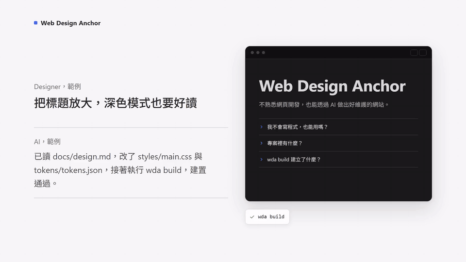

# Web Design Anchor

English | [繁體中文](docs/i18n/zh-TW/README.zh-TW.md) | [日本語](docs/i18n/ja/README.ja.md)

**Build websites with AI. Keep design decisions in your project.**



This is a demo animation. The conversation in the video is an example.

WDA helps you build and maintain a simple static website with an AI coding tool. You don't need to write the code yourself. You need an AI coding tool that can run commands on your computer, such as Claude Code or Codex. A chat window that cannot run commands on your computer is not enough. Git is optional, and a project with Git gets a local history. The project that WDA creates has a clear structure, and pages, styles, and design rules each have a fixed place. Design choices such as colors and type sizes live in one place, so you can change them across the whole site.

WDA provides a standardized CLI and project rules. It keeps the design rules in the project's `docs/design.md` and Design Tokens, so they do not depend on a single AI conversation. The AI can read these files before it changes the site. WDA does not guarantee that the AI follows every rule, so check the result with `wda check` and review the pages yourself.

On the technical side, WDA returns to standard Web and does not depend on a frontend framework. The native capabilities of HTML5 and Modern CSS are enough to handle rich layouts and dynamic effects. The scripting layer uses TypeScript, which keeps the code maintainable and orderly.

For build and delivery, WDA type-checks TypeScript with one pinned TypeScript tool and bundles the site with a native Rust bundler. It writes all output to the `dist/` directory. The WDA program itself does not need Deno, Node.js, or Bun. Each user works with a different Coding Agent or IDE, so WDA does not include a preview server. Each user's environment handles previews. `dist/` holds a static website that does not need WDA to run, so users can inspect the result directly and deploy from it at any time. The output can include third-party packages that the project uses, such as Lit.

## Quick Start

Four steps take you to your first website.

### 1. Install WDA and the optional tools

WDA Minimal needs no Deno, Node.js, or Bun. Git is optional. When Git is on PATH, WDA also creates a local Git repository for your project. The default Spectrum and Lit packages use an existing package manager, npm or Bun. WDA never installs Node.js or Bun.

After you install WDA, run the version check:

```sh
wda --version
```

For detailed installation methods, see the Installation Guide section below.

### 2. Create a new project

Create an empty folder for the project, move into it, and run the initialization command:

```sh
mkdir my-site
cd my-site
wda init
```

`wda init` creates a standard WDA project in the current folder. It includes the WDA settings file `anchor.json`, the website package file `package.json`, the design rules `docs/design.md`, the home page `pages/index.html`, and the Design Tokens `tokens/tokens.json`. When Git is available, it also creates a local Git repository with an initial commit. If the folder already contains `.git/`, `package.json`, or another file or folder that `wda init` needs to create, the command stops before it writes anything. When more than one package manager is usable, pass the name you want with `wda init --package-manager npm` or `wda init --package-manager bun`. When no usable manager exists, or the registry cannot be reached, `wda init` creates a complete WDA Minimal project. For the full list of files, see `docs/commands.md`.

### 3. Design with an AI

Ask your AI to read `docs/design.md` in the project before it makes changes. The AI can use the Design System rules in that file and the Tokens in `tokens/tokens.json` to write HTML, CSS, and Web Components. The file does not guarantee that the AI follows every rule, so check the result with `wda check` and look at the pages yourself.

While you make changes, run the validation at any time:

```sh
wda check
```

`wda check` validates the project contract, the required documents, specific HTML rules, and the Token structure. It does not judge visual quality or full accessibility. Review the pages in a browser for those.

### 4. Build a deployable website

When the design is done, run the build command:

```sh
wda build
```

WDA type-checks the TypeScript that the pages reference and packages all static assets into `dist/`. The build reads the packages that your package manager has already installed. It does not install them. If a page uses a TypeScript script and the TypeScript tool cache is missing, run `wda tools fetch` and then build again. Preview the result through a local HTTP static server, or deploy `dist/` to a static site host. If the output uses features such as ES modules that do not work over `file://`, opening the HTML file directly does not work correctly.

## Installation Guide

WDA is one program, and each project keeps its own website packages. Git and a package manager are optional. Lit is a website package that the Spectrum default declares in `package.json`. It is not a global tool, and your package manager installs it into the project.

### Install Git (optional)

Git gives a project a local history. Choose one preferred path for your operating system:

| Platform | Preferred Git path | Official alternative sources |
| --- | --- | --- |
| Windows | `winget install --id Git.Git -e --source winget` | [Git for Windows installer](https://git-scm.com/install/windows) |
| macOS | `brew install git` | [Git macOS installation options](https://git-scm.com/download/mac) |
| Debian/Ubuntu | `sudo apt-get install git` | [Git Linux installation options](https://git-scm.com/download/linux) |
| Fedora | `sudo dnf install git` | [Git Linux installation options](https://git-scm.com/download/linux) |

After installation, run `git --version` to confirm that Git works. If the command cannot find Git, open a new terminal window and check again. Without Git, `wda init` still creates the project, skips the Git repository and the first commit, and reports a warning.

### Install npm or Bun (optional, for the default packages)

The default Spectrum and Lit packages need npm or Bun on PATH. Install one of them with its official installer. WDA does not install either one, and WDA Minimal does not need either one. When you have neither, `wda init` creates WDA Minimal, and the Skill can add the default packages later after you agree.

### Install WDA

The public GitHub repository provides stable releases and prereleases. View the available versions on [GitHub Releases](https://github.com/monkey1wizard/Web-Design-Anchor/releases).

Choose one installation method for your operating system:

#### macOS and Linux

```sh
brew install monkey1wizard/tap/wda
```

Or use the install script:

```sh
curl -fsSL https://raw.githubusercontent.com/monkey1wizard/web-design-anchor/main/packaging/install.sh | bash
```

#### Windows

Use the PowerShell install script:

```sh
irm https://raw.githubusercontent.com/monkey1wizard/web-design-anchor/main/packaging/install.ps1 | iex
```

The WinGet package is still under review and is not yet available.

#### Rust already installed

If you already have the Rust toolchain, you can install with Cargo:

```sh
cargo install --git https://github.com/monkey1wizard/Web-Design-Anchor --locked
```

### The TypeScript tool

WDA type-checks scripts with one official TypeScript version that this WDA release embeds. Release builds include the package for your platform. A source build tries to restore it during `wda init`. If that restore fails, `wda init` still creates the project and reports a warning. You can then run `wda tools fetch` with no arguments. The command restores only the version bound to this WDA release. It never changes `anchor.json` or `package.json`.

### Confirm the installation

After installation, run `wda --version` in a read-only way to confirm that WDA starts. If you installed Git, run `git --version` too. For example:

```sh
wda --version
```

If a tool is not found on PATH, confirm the install location and reopen the terminal. If a tool is found but cannot start, keep the launch error and troubleshoot from the actual error. The AI must not invent an exit status, and it must not treat a launch failure as proof that the tool is not installed.

## Core Commands

WDA provides three project commands and one tool command:

| Command | Responsibility | Description |
| :--- | :--- | :--- |
| `wda init` | Project initialization | Creates the standard project structure, `anchor.json`, `package.json`, the design anchor document, and the home page template. Calls your package manager only to install the default packages |
| `wda check` | Static validation | Validates the contract, the document structure, HTML tag rules, and Token references. It never installs packages and never uses the network |
| `wda build` | Build and delivery | Type-checks TypeScript, bundles the installed packages, and writes all output to the `dist/` directory. It never installs packages and never uses the network |
| `wda tools fetch` | TypeScript tool cache | Restores the TypeScript tool that this WDA release embeds, for the current platform. It takes no arguments |

For detailed parameters and diagnostic output, see `docs/commands.md`.

### Website packages

The package manager owns website package installation, updates, and locking. As an exception, `wda init` calls it to install the default packages. `package.json` declares them, and the package manager you use owns the lockfile and `node_modules`. Add, remove, and update packages with that manager's own commands, for example `npm install <package>` or `bun add <package>`. Then run `wda check` and `wda build`.

The `wda deps` command has been removed. Running it prints a usage error that names the external package manager, and WDA keeps no alias for it.

## Working with an AI

WDA is designed for collaboration with an AI. The project provides an official Skill:

- **Official Skill**: It is located in `skills/wda/`. Use the Skill from the same release or source revision as your CLI. If your Coding Agent supports Skills, load this directory. The Skill gives the AI instructions for the WDA commands and project rules. An agent may not load the Skill automatically, so confirm that the AI uses it. If it does not, ask the AI to load the Skill, or follow the steps for an environment without a Skill.
- **Environment without a Skill**: If the AI does not have the WDA Skill, first give it this README or another readable official WDA source. If the AI cannot read the source, it must ask you to provide an accessible source and then stop. The AI should not guess installation commands. After the project is created, ask the AI to generate code from that project's `docs/design.md` and to run `wda check` at every stage to validate it.

## Documentation Map

| What you want to know | Document |
| :--- | :--- |
| What WDA consists of, where its boundaries are, and the development, verification, and documentation rules | `docs/architecture.md` |
| The project that `wda init` produces: `anchor.json` and `package.json` fields, the project tree, and the `dist/` mapping | `docs/generated-project.md` |
| What the commands do and how to read diagnostic output | `docs/commands.md` |
| Design System default and fallback, Tokens, and the Adapter boundary | `docs/design-system.md` |
| What a Skill may contain and how it is verified | `docs/skill-spec.md` |
| Term and vocabulary definitions | `docs/glossary.md` |
| Which decisions are settled and the reasons behind them | `docs/adr/` |
| Concrete definitions of WDA Minimal and Spectrum | `docs/design-systems/` |
| The document templates that `wda init` writes into a project | `docs/templates/generated-project/` |
| The scope of the security model and how to report a vulnerability | `SECURITY.md` |
| How an AI operates `wda` | `skills/wda/SKILL.md` |

## License

Apache-2.0. For third-party material and component licenses, see `NOTICE`.
Section 10, "Craft Floor", of `docs/design.md` is adapted from [impeccable](https://github.com/pbakaus/impeccable). It adopts only a small part of that project's criteria, and the license is Apache-2.0. Readers who need the full design process can consult that project.
