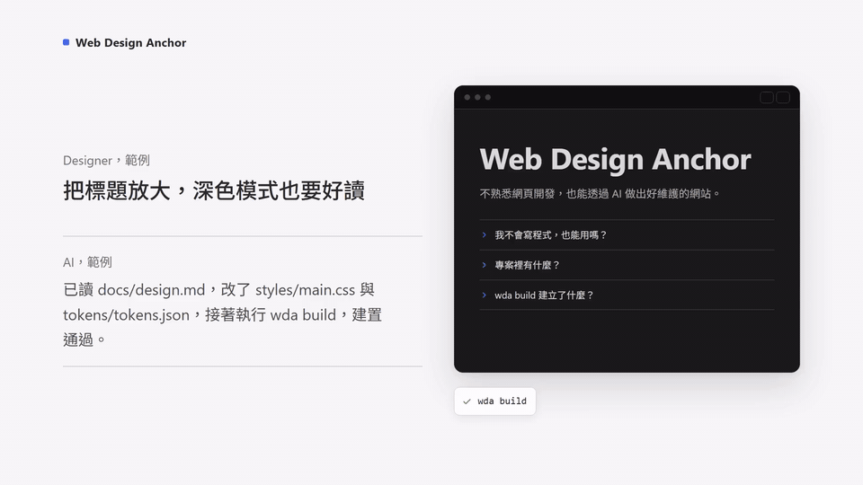

# Web Design Anchor

[English](../../../README.md) | [繁體中文](../zh-TW/README.zh-TW.md) | 日本語

**AIでWebサイトを作り、デザインの決定はプロジェクトに残す。**



これはデモアニメーションである。動画内の会話は一例である。

WDAを使うと、AIコーディングツールと一緒にシンプルな静的Webサイトを構築し、保守できる。コードを自分で書く必要はない。ただし、Claude CodeやCodexのように自分のコンピューターでコマンドを実行できるAIコーディングツールが必要であり、GitとDenoもインストールしておく必要がある。コンピューターでコマンドを実行できないチャット画面だけでは足りない。生成されるWebプロジェクトは構成が明確で、ページ、スタイル、デザイン規則にそれぞれ決まった場所がある。色や文字サイズなどのデザインの選択は一か所にまとめてあり、サイト全体に対して変更できる。

WDAは標準化されたCLIとプロジェクト規則を提供する。デザイン規則はプロジェクト内の`docs/design.md`とDesign Tokensに保存するため、1回のAIとの会話に依存しない。AIはサイトを変更する前にこれらのファイルを読める。WDAは、AIがすべての規則に従うことを保証しない。結果は`wda check`で確認し、ページも自分で確認する。

技術面では、WDAはフロントエンドフレームワークに依存せず、標準Webに立ち戻る。HTML5とModern CSSのネイティブ機能で、豊かなレイアウトや動的な効果を実現できる。スクリプトにはTypeScriptを使い、保守しやすく整理されたコードを保つ。

ビルドと配布にはDenoを使い、TypeScriptスクリプトとプロジェクト資産をすばやく変換して、すべての出力を`dist/`ディレクトリに書き込む。利用者ごとにCoding AgentやIDEが異なるため、WDAにはプレビューサーバーを含めない。プレビューは各自の環境で行う。`dist/`にはWDAなしで動作する静的Webサイトが格納され、成果を直接確認し、いつでもデプロイできる。出力には、Litなどプロジェクトが使うサードパーティーのパッケージが含まれる場合がある。

## クイックスタート

4つの手順で最初のWebサイトを作成できる。

### 1. 前提ツールとWDAをインストールする

GitとDenoがコンピューターにインストールされ、どちらもPATH環境変数に追加されていることを確認する。WDAにNode.jsは不要である。

WDAをインストールしたら、バージョンを確認する。

```sh
wda --version
```

詳しいインストール方法は、下記のインストールガイドを参照する。

### 2. 新しいプロジェクトを作成する

プロジェクト用の空のフォルダーを作成し、そのフォルダーに移動してから初期化コマンドを実行する。

```sh
mkdir my-site
cd my-site
wda init
```

`wda init`は現在のフォルダーに標準的なWDAプロジェクトを作成する。設定ファイル`wda.json`、デザイン規則`docs/design.md`、ホームページ`pages/index.html`、Design Tokens`tokens/tokens.json`が含まれる。初回コミットを含むローカルGitリポジトリも作成する。フォルダーに`.git/`や、`wda init`が作成するファイルやフォルダーがすでにある場合、コマンドは何も書き込まずに停止する。作成されるファイルの一覧は`docs/commands.md`を参照する。

### 3. AIとデザインする

変更を始める前に、プロジェクトの`docs/design.md`を読むようAIに依頼する。AIはこのファイルのDesign Systemの規則と、`tokens/tokens.json`のTokenを使って、HTML、CSS、Web Componentsを書ける。このファイルはAIがすべての規則に従うことを保証しないため、結果を`wda check`で確認し、ページも自分で確認する。

変更中はいつでも次の検証を実行できる。

```sh
wda check
```

`wda check`は、プロジェクト契約、必須ドキュメント、特定のHTML規則、Tokenの構造を検証する。見た目の品質やアクセシビリティの全項目は判定しない。それらはブラウザーでページを見て確認する。

### 4. デプロイ可能なWebサイトをビルドする

デザインが完成したら、ビルドコマンドを実行する。

```sh
wda build
```

WDAはTypeScriptを変換し、すべての静的資産を`dist/`にまとめる。ローカルのHTTP静的サーバーでプレビューするか、`dist/`を静的サイトホストにデプロイする。出力にES modulesなど`file://`で動作しない機能が含まれる場合、HTMLファイルを直接開いても正しく動作しない。

## インストールガイド

WDAが使うツールには2つの階層がある。GitとDenoはコンピューター単位のツールであり、どちらもPATHに必要である。Litは各WDAプロジェクトの依存関係である。グローバルツールではなく、WDAが管理する。

### 先にGitとDenoをインストールする

使用するOSに合わせて、推奨される方法を1つ選ぶ。

| Platform | Preferred Git path | Preferred Deno path | Official alternative sources |
| --- | --- | --- | --- |
| Windows | `winget install --id Git.Git -e --source winget` | `winget install DenoLand.Deno` | [Git for Windows installer](https://git-scm.com/install/windows) and [Deno Windows installation options](https://docs.deno.com/runtime/getting_started/installation/) |
| macOS | `brew install git` | `brew install deno` | [Git macOS installation options](https://git-scm.com/download/mac) and [Deno installation options](https://docs.deno.com/runtime/getting_started/installation/) |
| Debian/Ubuntu | `sudo apt-get install git` | `curl -fsSL https://deno.land/install.sh \| sh` | [Git Linux installation options](https://git-scm.com/install/linux) and [Deno manual download](https://docs.deno.com/runtime/getting_started/installation/#manual-download) |
| Fedora | `sudo dnf install git` | `curl -fsSL https://deno.land/install.sh \| sh` | [Git Linux installation options](https://git-scm.com/install/linux) and [Deno manual download](https://docs.deno.com/runtime/getting_started/installation/#manual-download) |

インストール後、`git --version`と`deno --version`をそれぞれ実行し、各ツールが動作することを確認する。コマンドが見つからない場合は、新しいターミナルを開いて再度確認する。

### WDAをインストールする

公開GitHubリポジトリでは安定版とプレリリースを提供している。[GitHub Releases](https://github.com/monkey1wizard/Web-Design-Anchor/releases)で利用可能なバージョンを確認する。

OSに合ったインストール方法を1つ選ぶ。

#### macOSとLinux

```sh
brew install monkey1wizard/tap/wda
```

またはインストールスクリプトを使う。

```sh
curl -fsSL https://raw.githubusercontent.com/monkey1wizard/web-design-anchor/main/packaging/install.sh | bash
```

#### Windows

PowerShellインストールスクリプトを使う。

```sh
irm https://raw.githubusercontent.com/monkey1wizard/web-design-anchor/main/packaging/install.ps1 | iex
```

WinGetパッケージは審査中のため、まだ利用できない。

#### Rustをインストール済みの場合

Rustツールチェーンがすでにある場合は、Cargoでインストールできる。

```sh
cargo install --git https://github.com/monkey1wizard/Web-Design-Anchor --locked
```

#### インストールを確認する

インストール後、`git --version`、`deno --version`、`wda --version`を読み取り専用で実行し、3つのツールが起動することを確認する。例：

```sh
wda --version
```

ツールがPATH上に見つからない場合は、インストール先を確認してターミナルを再起動する。ツールが見つかっても起動できない場合は、実際のエラーを保存し、その内容に基づいて調査する。AIは終了ステータスを作り上げてはならず、起動失敗を未インストールの証拠として扱ってはならない。

## 主要コマンド

WDAはプロジェクトのライフサイクルを支える4つのコマンドを提供する。

| Command | Responsibility | Description |
| :--- | :--- | :--- |
| `wda init` | Project initialization | 標準プロジェクト構成、`wda.json`、デザインアンカー文書、ホームページのテンプレートを作成する |
| `wda check` | Static validation | 契約、文書構造、HTMLタグ規則、Token参照を検証する |
| `wda build` | Build and delivery | TypeScriptを変換し、資産をまとめて`dist/`に出力する |
| `wda deps` | Dependency management | Litなどの必須ライブラリのインストールや更新など、プロジェクト依存関係を管理する |

詳細なパラメーターと診断出力は`docs/commands.md`を参照する。

## AIと協業する

WDAはAIとの協業を前提に設計されている。公式Skillを提供する。

- **公式Skill**：`skills/wda/`にある。Coding AgentがSkillに対応している場合は、このディレクトリを読み込む。Skillは、WDAのコマンドとプロジェクト規則についての指示をAIに与える。AgentがSkillを自動で読み込むとは限らないため、AIがSkillを使っているか確認する。使っていない場合は、Skillを読み込むようAIに依頼するか、Skillが使えない環境の手順に従う。
- **Skillが使えない環境**：AIにこのREADMEまたは他の読み取り可能な公式WDA資料を渡す。資料を読めない場合は、アクセス可能な資料の提供を求めて停止しなければならない。AIはインストールコマンドを推測してはならない。プロジェクト作成後は、そのプロジェクトの`docs/design.md`からコードを生成し、各段階で`wda check`を実行して検証するよう依頼する。

## ドキュメント案内

| 知りたいこと | ドキュメント |
| :--- | :--- |
| WDAの構成、境界、開発・検証・文書化の規則 | `docs/architecture.md` |
| `wda init`が作成するプロジェクト：`wda.json`のフィールド、ツリー、`dist/`のマッピング | `docs/generated-project.md` |
| 4つのコマンドの動作と診断出力の読み方 | `docs/commands.md` |
| Design Systemの既定値とフォールバック、Token、Adapter境界 | `docs/design-system.md` |
| Skillに含められる内容と検証方法 | `docs/skill-spec.md` |
| 用語の定義 | `docs/glossary.md` |
| 決定事項とその理由 | `docs/adr/` |
| WDA MinimalとSpectrumの具体的な定義 | `docs/design-systems/` |
| `wda init`がプロジェクトに書き込む文書テンプレート | `docs/templates/generated-project/` |
| セキュリティモデルの範囲と脆弱性の報告方法 | `SECURITY.md` |
| AIによる`wda`の操作方法 | `skills/wda/SKILL.md` |

## ライセンス

Apache-2.0。サードパーティ素材とコンポーネントのライセンスは`NOTICE`を参照する。
`docs/design.md`のSection 10「Craft Floor」は[impeccable](https://github.com/pbakaus/impeccable)を基にしている。同プロジェクトの基準の一部のみを採用しており、ライセンスはApache-2.0である。デザインプロセス全体が必要な場合は、同プロジェクトを参照できる。
