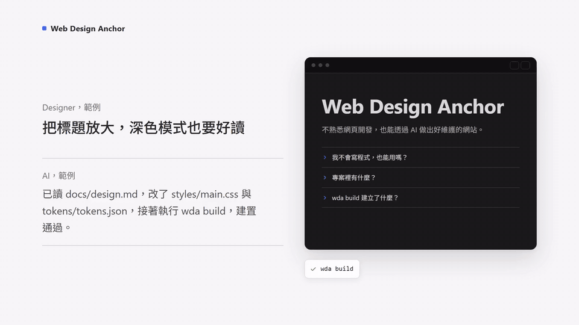

# Web Design Anchor

[English](../../../README.md) | 繁體中文 | [日本語](../ja/README.ja.md)

**用 AI 做網站，讓設計規則留在專案裡。**



示範動畫，影片中的對話是範例。

WDA 協助你搭配 AI 程式開發工具建立並維護簡單的靜態網站，你不需要自己寫程式碼。你需要能在自己電腦上執行指令的 AI 程式開發工具，例如 Claude Code 或 Codex。無法在你電腦上執行指令的聊天視窗並不足夠。Git 為選用工具，有 Git 的專案會取得本機歷史紀錄。產出的網頁專案架構清楚，頁面、樣式和設計規範都有固定的位置。配色、字級等設計選擇集中存放，你可以一次調整整個網站。

WDA 提供標準化的 CLI 與專案規範，並把設計規則存放在專案內的 `docs/design.md` 與 Design Tokens，不依賴某一次 AI 對話。AI 可以在修改網站前讀取這些檔案。WDA 不保證 AI 遵守每一條規則，請用 `wda check` 檢查結果，並親自檢視頁面。

在技術架構上，WDA 回歸標準 Web，不依賴前端框架。HTML5 與 Modern CSS 的原生能力，足以處理豐富的版面與動態特效。腳本層則採用 TypeScript，讓程式碼好維護、不混亂。

在建置與交付上，WDA 以一個釘定版本的 TypeScript 工具檢查型別，並用原生 Rust 打包器打包網站，統一輸出至 `dist/` 目錄。WDA 程式本身不需要 Deno、Node.js 或 Bun。每位使用者搭配的 Coding Agent 或 IDE 各不相同，因此 WDA 本身不內建預覽伺服器，預覽交由使用者的環境自行處理。`dist/` 產出的是不需要 WDA 就能執行的靜態網頁，使用者能直接檢視成果，隨時以此部署。產出內容可能包含專案使用的第三方套件，例如 Lit。

## 快速開始

四個步驟即可完成第一個網站：

### 1. 安裝 WDA 與選用工具

WDA Minimal 不需要 Deno、Node.js 或 Bun。Git 為選用工具。Git 在 PATH 中時，WDA 也會為專案建立本機 Git 儲存庫。預設的 Spectrum 與 Lit 套件使用既有的套件管理工具 npm 或 Bun。WDA 不會自行安裝 Node.js 或 Bun。

安裝 WDA 後，執行版本檢查：

```sh
wda --version
```

詳細安裝方式請見下方的安裝指南章節。

### 2. 建立新專案

建立專案用的空資料夾，進入該資料夾後執行初始化指令：

```sh
mkdir my-site
cd my-site
wda init
```

`wda init` 會在目前的資料夾建立標準 WDA 專案。專案包含 WDA 設定檔 `anchor.json`、網站套件宣告檔 `package.json`、設計規範 `docs/design.md`、首頁 `pages/index.html` 與 Design Tokens `tokens/tokens.json`。Git 可用時，它也會建立含初始 commit 的本機 Git 儲存庫。若資料夾內已有 `.git/`、`package.json` 或其他 `wda init` 需要建立的檔案或資料夾，指令會在寫入任何內容前停止。當可用的套件管理工具不只一個時，請用 `wda init --package-manager npm` 或 `wda init --package-manager bun` 指定要使用的名稱。沒有可用的套件管理工具，或無法連到 registry 時，`wda init` 會建立完整的 WDA Minimal 專案。完整檔案清單請參閱 `docs/commands.md`。

### 3. 與 AI 協作設計

請 AI 在修改前先讀取專案內的 `docs/design.md`。AI 可以依這份文件中的 Design System 規範，以及 `tokens/tokens.json` 中的 Token，撰寫 HTML、CSS 與 Web Components。這份文件不保證 AI 遵守每一條規則，請用 `wda check` 檢查結果，並親自檢視頁面。

在修改過程中，隨時執行驗證：

```sh
wda check
```

`wda check` 驗證專案合約、必要文件、特定 HTML 規則與 Token 結構，不判斷視覺品質，也不涵蓋完整的無障礙檢查。這些部分請在瀏覽器中檢視頁面確認。

### 4. 建置可部署網站

完成設計後執行建置指令：

```sh
wda build
```

WDA 會對頁面引用的 TypeScript 進行型別檢查，並將所有靜態資產打包輸出至 `dist/`。建置會讀取套件管理工具已安裝的套件，本身不會安裝套件。若頁面使用 TypeScript 腳本而工具快取缺少，請執行 `wda tools fetch`，然後重新建置。請透過本地 HTTP 靜態伺服器預覽，或將 `dist/` 部署至靜態網站主機。若產出物使用 ES module 等不支援 `file://` 的功能，直接開啟 HTML 檔案無法正常運作。

## 安裝指南

WDA 是一個程式，每個專案各自保有網站套件。Git 與套件管理工具都是選用工具。Lit 是預設 Spectrum 在 `package.json` 中宣告的網站套件。它不是全域工具，由你的套件管理工具安裝到專案內。

### 安裝 Git（選用）

Git 讓專案取得本機歷史紀錄。請依作業系統選擇一組偏好路徑：

| 平台 | Git 偏好路徑 | 官方替代來源 |
| --- | --- | --- |
| Windows | `winget install --id Git.Git -e --source winget` | [Git for Windows 安裝程式](https://git-scm.com/install/windows) |
| macOS | `brew install git` | [Git macOS 安裝選項](https://git-scm.com/download/mac) |
| Debian／Ubuntu | `sudo apt-get install git` | [Git Linux 安裝選項](https://git-scm.com/download/linux) |
| Fedora | `sudo dnf install git` | [Git Linux 安裝選項](https://git-scm.com/download/linux) |

安裝後執行 `git --version` 確認可用。如果指令找不到 Git，請開啟新的終端機視窗再檢查。沒有 Git 時，`wda init` 仍會建立專案，略過 Git 儲存庫與第一次 commit，並回報警告。

### 安裝 npm 或 Bun（選用，用於預設套件）

預設的 Spectrum 與 Lit 套件需要 PATH 中有 npm 或 Bun。請用其官方安裝程式安裝其中一種。WDA 不會安裝這兩者，WDA Minimal 也不需要它們。兩者都沒有時，`wda init` 會建立 WDA Minimal，之後 Skill 可在你同意後加入預設套件。

### 安裝 WDA

公開 GitHub 儲存庫提供穩定版與 prerelease。請在 [GitHub Releases](https://github.com/monkey1wizard/Web-Design-Anchor/releases) 檢視可用版本。

依作業系統選擇一種方式安裝：

#### macOS 與 Linux

```sh
brew install monkey1wizard/tap/wda
```

或使用安裝腳本：

```sh
curl -fsSL https://raw.githubusercontent.com/monkey1wizard/web-design-anchor/main/packaging/install.sh | bash
```

#### Windows

使用 PowerShell 安裝腳本：

```sh
irm https://raw.githubusercontent.com/monkey1wizard/web-design-anchor/main/packaging/install.ps1 | iex
```

（WinGet 套件仍在審核中，尚不可用）

#### 已安裝 Rust

若已安裝 Rust 工具鏈，可使用 Cargo 安裝：

```sh
cargo install --git https://github.com/monkey1wizard/Web-Design-Anchor --locked
```

### TypeScript 工具

WDA 以本次 WDA 發行版內嵌的單一官方 TypeScript 版本檢查腳本。發行版建置會包含你平台的套件。原始碼建置會在 `wda init` 時嘗試還原它。若還原失敗，`wda init` 仍會建立專案並回報警告。之後你可以不帶參數執行 `wda tools fetch`。此指令只還原與本次 WDA 發行版綁定的版本，且不會修改 `anchor.json` 或 `package.json`。

### 確認安裝

完成安裝後，執行 `wda --version` 確認 WDA 可以啟動。如果你安裝了 Git，也請執行 `git --version`。例如：

```sh
wda --version
```

若 PATH 中找不到工具，請確認安裝位置並重新開啟終端機。若工具找到但無法啟動，請保留啟動錯誤，依實際錯誤排查。AI 不得虛構結束狀態，也不能把啟動失敗當作工具尚未安裝。

## 核心指令

WDA 提供三個專案指令與一個工具指令：

| 指令 | 職責 | 說明 |
| :--- | :--- | :--- |
| `wda init` | 專案初始化 | 建立標準專案結構、`anchor.json`、`package.json`、設計定錨文件與首頁範本。只在安裝預設套件時呼叫套件管理工具 |
| `wda check` | 靜態驗證 | 驗證合約、文件結構、HTML 標籤規範與 Token 引用。永不安裝套件，也不使用網路 |
| `wda build` | 建置交付 | 進行 TypeScript 型別檢查、打包已安裝的套件，統一輸出至 `dist/` 目錄。永不安裝套件，也不使用網路 |
| `wda tools fetch` | TypeScript 工具快取 | 還原本次 WDA 發行版內嵌的 TypeScript 工具，適用於目前的平台。不接受參數 |

詳細參數與診斷說明請參閱 `docs/commands.md`。

### 網站套件

網站套件的安裝、更新與鎖定由套件管理工具負責。例外是 `wda init` 會呼叫該工具安裝預設套件。`package.json` 負責宣告套件，你使用的套件管理工具負責鎖定檔與 `node_modules`。請用該工具自己的指令新增、移除與更新套件，例如 `npm install <package>` 或 `bun add <package>`。之後再執行 `wda check` 與 `wda build`。

`wda deps` 指令已移除。執行它會顯示用法錯誤，並指向外部套件管理工具。WDA 不保留它的別名。

## 搭配 AI 協作

WDA 專為 AI 協作設計。專案提供官方 Skill：

- **官方 Skill**：位在 `skills/wda/`。請使用與 CLI 來自同一版本或來源修訂的 Skill。若你使用的 Coding Agent 支援 Skill，請載入此目錄。Skill 會提供 AI 操作 WDA 指令與專案規範的指引。Agent 不一定會自動載入 Skill，請確認 AI 有使用它。若沒有，請要求 AI 載入 Skill，或依照無 Skill 環境的步驟操作。
- **無 Skill 環境**：如果 AI 沒有 WDA Skill，請先提供本 README 或另一份可讀取的官方 WDA 來源。若 AI 無法讀取，必須請你提供可存取的來源，然後停止。AI 不應自行猜測安裝指令。建立專案後，請 AI 依據該專案的 `docs/design.md` 產生程式碼，並在每階段執行 `wda check` 驗證。

## 文件導覽

| 想了解的內容 | 參閱文件 |
| :--- | :--- |
| WDA 由什麼組成、邊界在哪、開發驗證與文件規則 | `docs/architecture.md` |
| `wda init` 產出的專案：`anchor.json` 與 `package.json` 欄位、專案樹、`dist/` 對應 | `docs/generated-project.md` |
| 各指令做什麼、診斷輸出怎麼讀 | `docs/commands.md` |
| Design System 的預設與退回、Token、Adapter 邊界 | `docs/design-system.md` |
| Skill 能放什麼、如何驗收 | `docs/skill-spec.md` |
| 術語與詞彙定義 | `docs/glossary.md` |
| 哪些決策已裁定與其背景原因 | `docs/adr/` |
| WDA Minimal 與 Spectrum 的實例定義 | `docs/design-systems/` |
| `wda init` 寫進專案的文件範本 | `docs/templates/generated-project/` |
| 安全模型涵蓋範圍與漏洞回報方式 | `SECURITY.md` |
| AI 如何操作 `wda` | `skills/wda/SKILL.md` |

## 授權

Apache-2.0。第三方素材與元件授權請參閱 `NOTICE`。
`docs/design.md` 第 10 節「Craft Floor」改寫自 [impeccable](https://github.com/pbakaus/impeccable)，只採用其中一小部分判準，授權為 Apache-2.0。需要完整設計流程的讀者可參閱該專案。
